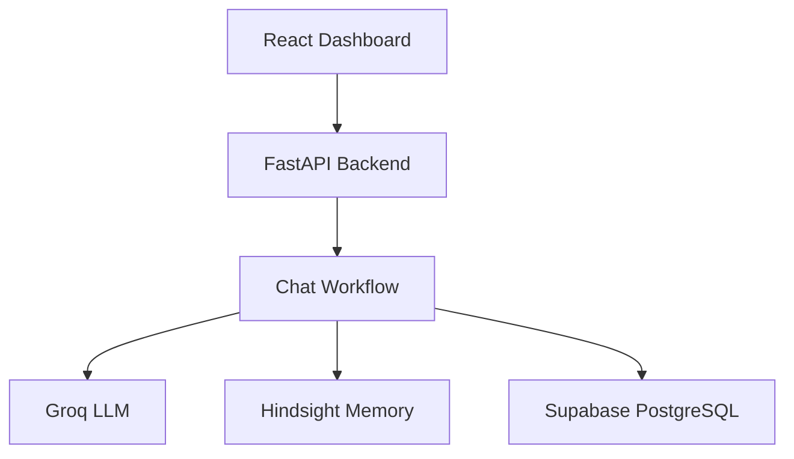

# RECALL AI

**Your customers never have to explain themselves twice.**

RECALL AI is an AI-powered customer support system built around persistent agent memory. It helps support agents remember customer conversations, retrieve relevant history, and adapt troubleshooting recommendations based on what has already been tried.

Instead of treating every support interaction as a fresh conversation, RECALL AI uses persistent memory to provide continuity across sessions.

## The Problem

Traditional AI support assistants can lose important context between conversations. Customers may need to repeat their issue, explain previous troubleshooting attempts, or receive recommendations they have already tried.

RECALL AI addresses this problem by combining an AI support agent with persistent memory.

## Core Capabilities

- **Persistent customer memory:** Retrieve relevant information from previous support interactions using Hindsight.
- **Context-aware troubleshooting:** Generate recommendations using the customer's current issue and available history.
- **Failed-action awareness:** Incorporate reported unsuccessful troubleshooting steps into subsequent recommendations.
- **Conversation history:** Persist customer conversations and support activity in Supabase.
- **Support dashboard:** Explore conversations, customers, memory, analytics, and support activity.
- **Development demo:** Demonstrate a synthetic customer journey across multiple support sessions.

## Product Experience

The dashboard includes:

| Section | Purpose |
|---|---|
| Overview | Support activity and operational summary |
| Support Inbox | Customer conversations and AI-assisted replies |
| Customers | Customer profiles and support history |
| Memory Explorer | Explore remembered information |
| Activity | Review support and agent activity |
| Analytics | Explore support metrics |
| Knowledge Base | View support knowledge resources |
| Integrations | Review connected services |
| Settings | Configure application settings |


## Architecture



### Request Lifecycle

1. The frontend sends a customer message to FastAPI.
2. The backend validates the request and workspace context.
3. The workflow retrieves relevant customer and conversation context.
4. Hindsight provides persistent memory.
5. The Groq-powered agent generates a context-aware response.
6. Conversation data and relevant memory updates are persisted.
7. The response is returned to the frontend.

### Technology Stack

| Layer | Technologies |
|---|---|
| Frontend | React 19, TypeScript, Vite |
| UI | Tailwind CSS, Framer Motion, Lucide |
| Visualization | Recharts |
| Backend | Python 3.11, FastAPI, Pydantic |
| LLM provider | Groq |
| Model | `openai/gpt-oss-120b` |
| Agent memory | Hindsight |
| Database | Supabase PostgreSQL |
| Testing | Pytest, pytest-asyncio |


## Repository Structure

```text
recall-ai/
├── backend/
│   ├── app/
│   │   ├── agents/          # Support agent and prompts
│   │   ├── api/routes/      # FastAPI endpoints
│   │   ├── core/            # Configuration and security
│   │   ├── database/        # Supabase repositories
│   │   ├── memory/          # Hindsight integration
│   │   ├── schemas/         # Request and response models
│   │   └── services/        # Chat workflow
│   ├── database/            # SQL schema
│   ├── scripts/             # Demo and seeding scripts
│   ├── tests/               # Backend tests
│   ├── .env.example
│   └── requirements.txt
├── frontend/
│   ├── public/
│   └── src/
│       ├── components/
│       ├── data/
│       ├── pages/
│       ├── services/
│       └── types/
├── contracts/
│   └── api-spec.yaml
├── docs/
└── README.md
```


## Getting Started

### Prerequisites

- Python 3.11
- Node.js and npm
- A Supabase project
- A Groq API key
- Hindsight API access and credentials

### 1. Clone the repository

```bash
git clone <YOUR_REPOSITORY_URL>
cd recall-ai
```

### 2. Configure the backend

```bash
cd backend
python3.11 -m venv .venv
source .venv/bin/activate
pip install -r requirements.txt
cp .env.example .env
```

Edit `backend/.env` and configure your credentials:

| Variable | Purpose |
|---|---|
| `APP_ENV` | Application environment |
| `SECRET_KEY` | Application signing secret |
| `FRONTEND_URL` | Frontend CORS origin |
| `GROQ_API_KEY` | Groq API credential |
| `GROQ_MODEL` | Language model identifier |
| `SUPABASE_URL` | Supabase project URL |
| `SUPABASE_SERVICE_ROLE_KEY` | Backend database credential |
| `HINDSIGHT_API_KEY` | Hindsight API credential |
| `HINDSIGHT_BASE_URL` | Hindsight API base URL |
| `HINDSIGHT_BANK_ID_SECRET` | Hindsight bank identity secret |
| `IDENTITY_TOKEN_SECRET` | Identity-token verification secret |

Never commit `.env` or expose service-role credentials in frontend code.

### 3. Initialize the database

Execute `backend/database/schema.sql` in your Supabase project's SQL Editor.

The schema defines workspaces, memberships, customers, conversations, messages, support tickets, and agent activity, with indexes and row-level security policies.

### 4. Start the backend

From the `backend` directory:

```bash
source .venv/bin/activate
uvicorn app.main:app --reload --host 127.0.0.1 --port 8000
```

Backend URL: `http://localhost:8000`

Health endpoint: `http://localhost:8000/health`

### 5. Start the frontend

Open another terminal:

```bash
cd frontend
npm install
npm run dev
```

Frontend URL: `http://localhost:5173`

Ensure `FRONTEND_URL` in the backend environment matches the frontend origin.


## API Reference

The backend exposes the following endpoints:

| Method | Endpoint | Description |
|---|---|---|
| `GET` | `/health` | Backend health and service status |
| `POST` | `/api/v1/chat` | Process a customer support message |
| `POST` | `/api/v1/demo/chat` | Run the synthetic customer demonstration |

### Customer Chat

`POST /api/v1/chat`

The regular chat endpoint requires:

- `X-Workspace-ID`: Workspace UUID.
- `Idempotency-Key`: Unique request key (16–128 characters).
- A JSON request body containing the chat request.

The endpoint processes customer messages through the support workflow, using persistent memory to retrieve relevant customer context.

### Synthetic Demo

`POST /api/v1/demo/chat`

The demo endpoint is restricted to development environments with synthetic demo seeding explicitly enabled. It uses a locally configured synthetic customer and is not a production customer-facing endpoint.

Do not expose this development endpoint publicly or publish its private demo credentials.

### Interactive API Documentation

When the backend is running, FastAPI provides interactive API documentation at:

`http://localhost:8000/docs`

## Current Project Status

RECALL AI is a working prototype demonstrating persistent customer memory across support conversations.

The project includes a multi-page support dashboard, a FastAPI backend, database integration, Hindsight-powered memory, and a synthetic customer demonstration.

The prototype is intended for evaluation and further development. Production deployment requires additional security, authentication, operational, and integration work.
