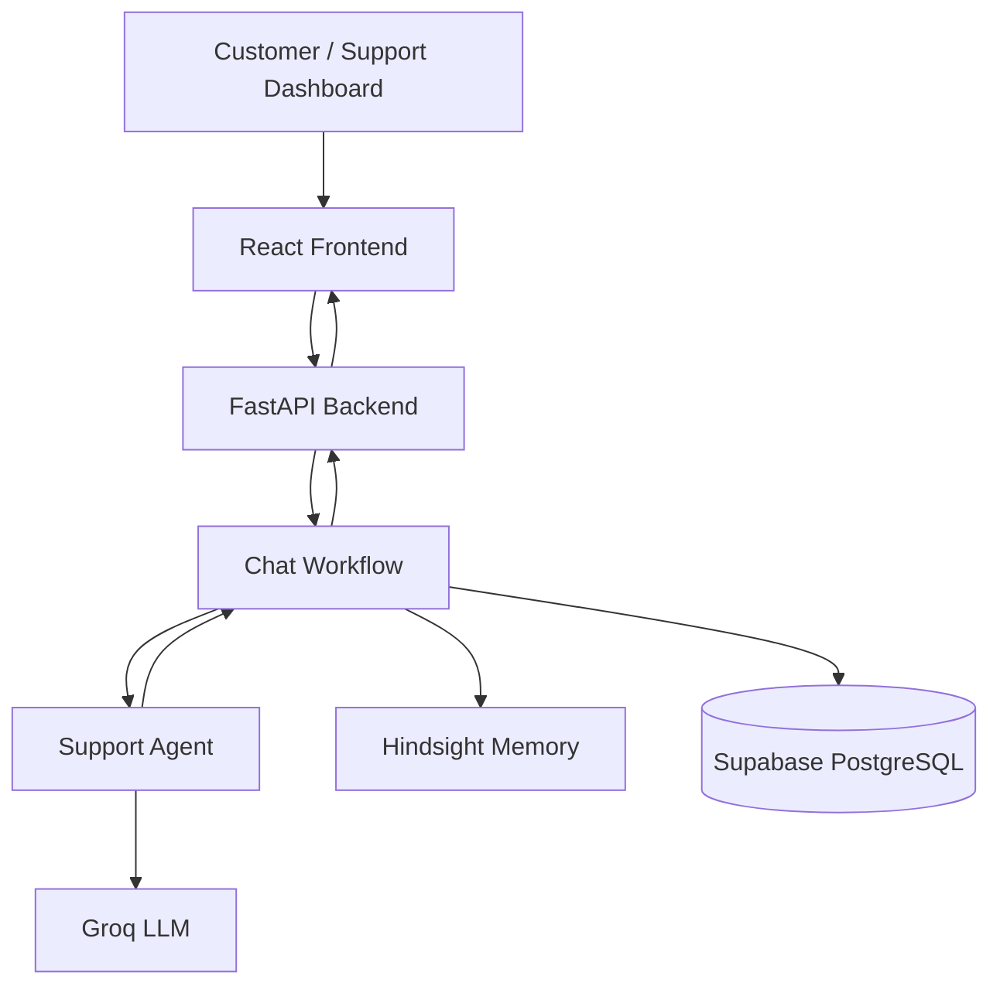

# RECALL AI — System Architecture

## 1. Overview

RECALL AI is an AI-powered customer support system designed to maintain continuity across customer interactions.

Its architecture combines a React dashboard, FastAPI backend, Groq language model, Hindsight persistent memory, and Supabase PostgreSQL.

The central design principle is that customer support should consider both the current issue and relevant information from previous interactions.

## 2. High-Level Architecture

## 3. Core Components

### Frontend

The React application provides the support dashboard and customer interaction interface.

Responsibilities include:

- Displaying customer conversations and profiles.
- Sending messages to the backend.
- Exploring customer memory and support activity.
- Displaying analytics and operational information.
- Providing a synthetic customer demonstration.

Technologies: React, TypeScript, Vite, Tailwind CSS, Framer Motion, Recharts, and Lucide.

### Backend API

FastAPI acts as the application's central coordination layer.

Responsibilities include:

- Validating incoming requests.
- Enforcing workspace context and request idempotency.
- Coordinating the support workflow.
- Managing service initialization.
- Returning structured API responses.

### Support Agent

The support agent generates responses using the current customer issue and available historical context.

It incorporates relevant previous troubleshooting attempts when generating recommendations.

The agent uses Groq as its language model provider.

### Hindsight Memory

Hindsight provides persistent agent memory across conversations.

It allows the system to retain and retrieve relevant customer context instead of relying exclusively on the current conversation.

The memory integration is coordinated through the backend memory service.

### Supabase PostgreSQL

Supabase stores structured application data, including:

- Workspaces and workspace memberships.
- Customer profiles.
- Conversations and messages.
- Support tickets.
- Agent activity.

Hindsight and Supabase serve complementary purposes: persistent contextual memory and structured application records.

## 4. Customer Message Lifecycle

1. The frontend submits a customer message to the FastAPI backend.
2. The backend validates the workspace identifier and idempotency key.
3. The chat workflow loads the relevant customer and conversation context.
4. The memory service retrieves relevant information from Hindsight.
5. The support agent combines the current issue with available historical context.
6. Groq generates a response.
7. The workflow persists the conversation and associated application data.
8. The backend returns the response to the frontend.

The exact memory operations and persistence behavior depend on the configured services and workflow execution.

## 5. Persistent Memory and Failed Troubleshooting

A key RECALL AI capability is incorporating unsuccessful troubleshooting attempts into future support interactions.

For example:

**Initial interaction**

A customer reports that Bluetooth headphones disconnect every ten minutes. The support agent recommends restarting Bluetooth and reconnecting the headphones.

**Follow-up interaction**

The customer reports that forgetting and re-pairing the headphones did not resolve the issue.

**Later interaction**

The customer returns in a separate session and asks for another troubleshooting step. The system can use the available support history to suggest a different approach, such as checking firmware and operating-system updates.

This demonstrates how persistent memory can improve continuity across sessions.

It does not imply that every possible repeated recommendation is guaranteed to be prevented.

## 6. API Boundaries

| Method | Endpoint | Purpose |
|---|---|---|
| GET | `/health` | Service health and status |
| POST | `/api/v1/chat` | Customer support workflow |
| POST | `/api/v1/demo/chat` | Synthetic development demonstration |

The regular customer chat endpoint uses workspace context and idempotency protection.

The synthetic demo endpoint is restricted to explicitly enabled development environments.

## 7. Technology Choices

| Component | Technology |
|---|---|
| Frontend | React and TypeScript |
| Backend | FastAPI and Python |
| Language model | Groq |
| Model | `openai/gpt-oss-120b` |
| Persistent agent memory | Hindsight |
| Structured database | Supabase PostgreSQL |
| Testing | Pytest and pytest-asyncio |

## 8. Security Considerations

- Credentials are configured through environment variables.
- Service-role credentials must remain on the backend.
- Workspace identifiers are validated by the API.
- Idempotency keys help protect against duplicate request processing.
- Synthetic demo functionality is restricted to development configuration.
- Production deployment requires appropriate authentication, authorization, secret management, and operational monitoring.
